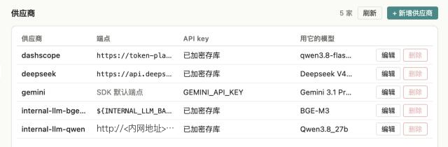
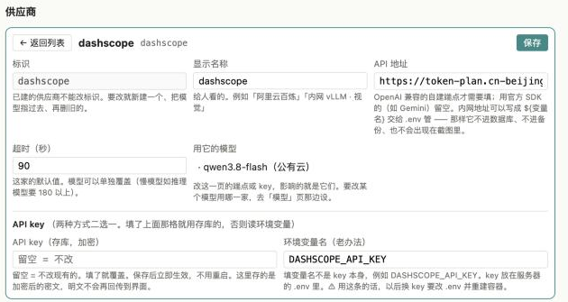
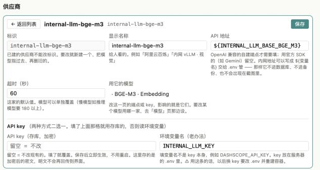
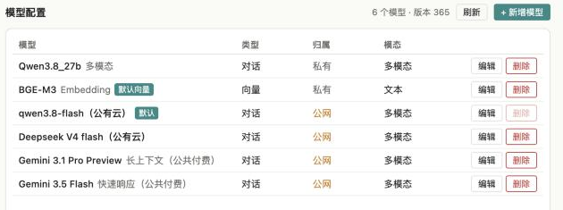
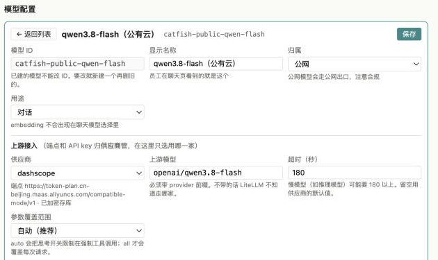
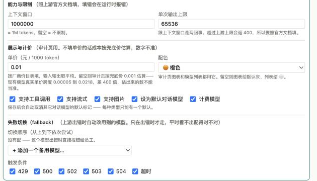
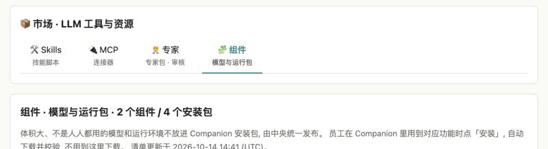
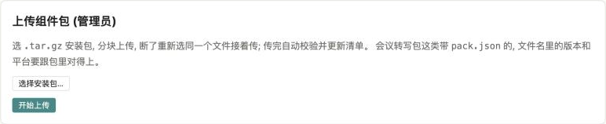
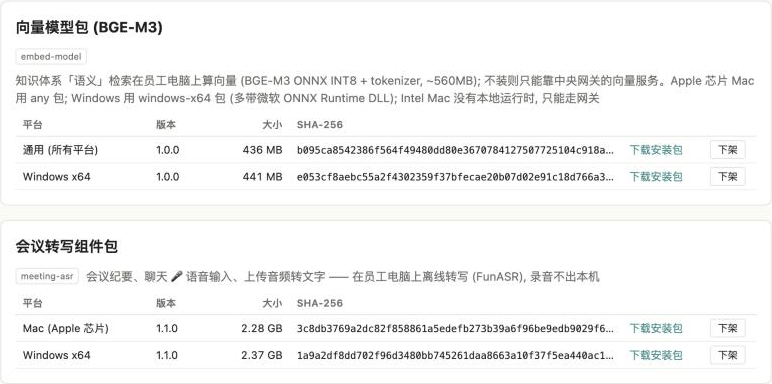

# 装好后配置模型和组件（附截图）

安装步骤见 `INSTALL.md`。这份只讲**装好之后在中央门户里要做的两件事**：

- 第一 ~ 四步：把模型配到能聊天（供应商填 key、选默认模型）
- 第五步：上传组件包（会议转写、向量模型），员工的 Companion 才装得上这些功能

全程在浏览器里做，**改完立即生效，不用重启**（内网地址那一项例外，见第三步）。

> 截图来自鲶鱼团队自己的环境，数据跟你装出来的大体一样；内网地址已打码。

---

## 第一步：进入「供应商」页

1. 浏览器打开门户 `https://<服务器IP>`，用装机时屏幕上打印的管理员账号登录（`users.yaml` 里那个 sysadmin）。
2. 顶部点「控制台」→ 左侧「接入」→「供应商」。

供应商 = 模型从哪家来（阿里云百炼、DeepSeek、Google、公司内网的模型服务……）。**API 地址和 key 都归供应商管**，一家填一次，挂在它下面的模型都能用。



| 列 | 看什么 |
|---|---|
| 端点 | 这家的 API 地址。`SDK 默认端点` = 用官方 SDK 的默认地址（Gemini 就是这样）；`${INTERNAL_LLM_BASE_…}` = 地址写在服务器 `.env` 里（见第三步） |
| API key | **`已加密存库`** = 已在界面上填过 key；显示一个变量名（如 `GEMINI_API_KEY`）= 从服务器 `.env` 读这个变量，`.env` 里没填就用不了 |
| 用它的模型 | 挂在这家下面的模型。还有模型挂着的供应商不能删（「删除」是灰的） |

新装好时，这里已经有出厂的几家：`dashscope`（阿里云百炼）、`deepseek`、`gemini`、`internal-llm-qwen-vision`（内网多模态）、`internal-llm-bge-m3`（内网向量）。**key 都还没填**，聊天会报「上游 LLM Provider 鉴权挂了」—— 下面第二、三步就是把它们填上。

---

## 第二步：给公网供应商填 key（阿里云百炼 / DeepSeek / Gemini）

点那一行的「编辑」：



- **API key（存库，加密）**：把从阿里云百炼 / DeepSeek / Google 后台申请到的 key 粘进来 → 右上角「保存」。**保存后立即生效。**
  - key 用装机时生成的 `CATFISH_SECRET_KEY` 加密后存进数据库，界面上永远不再显示明文。之后显示「留空 = 不改」，要换 key 就重新粘一个。
  - ⚠ `CATFISH_SECRET_KEY` 丢了，存库的 key 全部解不开，只能逐个重填 —— 装机时务必存进公司密码管理器（见 `INSTALL.md`）。
- **环境变量名（老办法）**：两种方式二选一。上面填了 key 就用存库的；上面留空才读这里写的环境变量（key 写在服务器 `.env` 里，改了要重建 gateway 容器）。**推荐用上面的存库方式。**
- **API 地址**：一般不用动。阿里云百炼的地址按账号不同，以百炼控制台给你的 OpenAI 兼容地址为准。
- **超时（秒）**：这家的默认值；某个模型慢（推理模型、多模态），可以在模型上单独加大（见第四步）。

用不到的公网供应商（例如公司不让用 Google）可以不填 —— 它下面的模型不会出现在员工的模型选择里。

---

## 第三步：内网模型（公司自己部署的 Qwen / BGE-M3）



出厂的内网供应商，API 地址是占位写法 `${INTERNAL_LLM_BASE_BGE_M3}` —— 表示**地址写在服务器 `.env` 里**，不进数据库、也不会出现在备份和截图里。两种填法任选：

**A. 写 `.env`（出厂就是这样）**

在服务器上编辑安装目录下的 `.env`：

```bash
INTERNAL_LLM_BASE_QWEN_VISION=http://<内网模型服务>/…/v1   # 多模态 Qwen 的 OpenAI 兼容地址
INTERNAL_LLM_BASE_BGE_M3=http://<内网模型服务>/…/v1        # BGE-M3 向量模型
INTERNAL_LLM_KEY=<内网模型服务的 key>                       # 两个内网供应商共用这一个
```

然后重建 gateway 容器让它读到：

```bash
docker compose up -d --force-recreate gateway
```

**B. 直接在界面填**

把「API 地址」改成真实地址（如 `http://10.x.x.x:端口/…/v1`），key 粘进「API key（存库，加密）」→ 保存，立即生效。缺点是内网地址会存进数据库。

---

## 第四步：看一眼模型，选默认模型

左侧「接入」→「模型」：



- **默认**（绿色标签）：员工没选过模型时用的那个。出厂默认是 `qwen3.8-flash（公有云）`。
- **默认向量**：知识库 / 文件搜索算向量用的模型。只有一个向量模型时它自动就是默认，不用管。
- **归属**：`私有` = 走公司内网；`公网` = 会把内容发到外部云服务，注意合规。
- 某个供应商没配 key，挂在它下面的模型员工就看不到，也不会被自动切换选中。

点「编辑」可以改一个模型：



- **显示名称**：员工在聊天页看到的名字。
- **归属**：私有 / 公网。
- **供应商**：这个模型走哪一家（地址和 key 跟着供应商走，这里只选）。
- **上游模型**：那一家的模型名，**必须带前缀**，OpenAI 兼容接口写 `openai/模型名`，DeepSeek 写 `deepseek/…`，Gemini 写 `gemini/…`。
- **超时（秒）**：慢模型（推理、多模态）建议 180 以上；留空用供应商的默认值。



- **上下文窗口 / 单次输出上限**：照模型官方文档填，填大了运行时会报错（上游返回 400）。
- **单价**：用于「用量审计」估算费用；不填按兜底价估。
- **设为默认对话模型**：勾上并保存，原来的默认会自动取消（每类只能有一个默认）。
- **失败切换（fallback）**：这个模型出错（限流 429、上游 5xx、超时）时，按顺序改用哪几个备用模型。内网模型建议只在内网之间切，或者明确接受切到公网。

改完点右上角「保存」，立即生效。

> 换「默认向量」模型时会弹确认：换了以后，已经算好的向量要全部重算（知识库会重建索引一段时间）。

---

## 第五步：上传组件包（会议转写 / 向量模型）

体积大、不是人人都用的模型和运行环境**不放进 Companion 安装包**，由中央统一发布：管理员在门户上传一次，员工在 Companion 里用到对应功能时点「安装」，自动从中央下载并校验，不用 IT 一台台拷。

| 组件 | 文件名（鲶鱼团队随安装包另外提供） | 干什么用 | 不上传的后果 |
|---|---|---|---|
| 会议转写组件包 | `meeting-asr-<版本>-mac-arm64.tar.gz`（约 2.3 GB）<br>`meeting-asr-<版本>-windows-x64.tar.gz`（约 2.4 GB） | 会议纪要、聊天里的 🎤 语音输入、上传音频转文字 —— 在员工电脑上离线转写，录音不出本机 | 这几个功能在员工那边装不上 |
| 向量模型包（BGE-M3） | `embed-model-<版本>-any.tar.gz`（约 440 MB，Apple 芯片 Mac 用）<br>`embed-model-<版本>-windows-x64.tar.gz`（约 440 MB） | 知识体系的「语义」检索在员工电脑上算向量 | 只能走中央网关的向量服务（第三步配的 BGE-M3） |

公司里只有 Windows 或只有 Mac 的，只传对应平台的包就行。

### 1. 打开「组件」页

门户顶部点「市场」→「组件」。上面列的是已经发布的组件，下面是上传卡片（**只有管理员账号看得到**）。



### 2. 上传



1. 点「选择安装包…」，选一个 `.tar.gz` 文件。
   - 下方会显示「将发布：名字 · 版本 · 平台」，核对一下。
   - 文件名必须是 `<名字>-<x.y.z>-<平台>.tar.gz`（平台是 `mac-arm64` / `mac-x64` / `windows-x64` / `any`），**不要改鲶鱼团队给的文件名**，改了会提示格式不对。
2. 点「开始上传」，看进度条、速度和剩余时间。
   - **中途断了不要紧**：页面关了、网断了、点了暂停，重新打开这页，再选**同一个文件**，会从断的地方接着传。
3. 传完自动校验（检查压缩包完整、包里的版本 / 平台跟文件名对得上、算 SHA-256），两个多 G 要等一会儿。
4. 出现「✓ 已发布 …，员工的 Companion 下次打开对应功能就能装」就好了。

每个包传一次，几个包依次传。

### 3. 确认

传完上面的列表里会多出一行：



- 每个组件下按平台列出版本、大小、SHA-256。某个平台缺包时会标出来（例如有 Mac 没 Windows = Windows 员工装不了）。
- 「下载安装包」：给断网、没法在 Companion 里装的电脑，IT 下载后手动拷过去用。
- 「下架」：撤掉这个包，员工那边就装不了了（已经装好的不受影响）。

### 升级组件

鲶鱼团队发新版本时（文件名里的版本号变大），照上面再传一次新文件就行；清单里每个平台只列最高版本，之后员工安装拿到的就是新版。
同一个版本号的包已经发布过，再传会被拒；确实要替换就勾「已经有同名的包就覆盖」—— **一般应该换版本号，不要覆盖**（同一个版本号两份不同的内容，出了问题没法分辨员工装的是哪一份）。

### 存在哪 / 要多少空间

组件包放在服务器安装目录下的 `components/` 里（`.env` 里的 `CATFISH_COMPONENTS_DIR` 可以改到别的盘）。四个包加起来约 5.5 GB，每次升级再加一份新版本 —— 旧版本不用了可以在页面上「下架」腾空间。备份时这个目录可以不备（丢了重新上传即可）。

### 上传报错

| 提示 | 原因 / 怎么办 |
|---|---|
| 文件名要是 `<名字>-<x.y.z>-<平台>.tar.gz` … | 文件名被改过，改回鲶鱼团队给的原名 |
| 已经发布过 …；要替换请勾选覆盖，或者换个版本号 | 同版本已发布，见上面「升级组件」 |
| 中央没配组件目录 / 组件目录不可写 | 安装目录下的 `components/`（或 `.env` 里 `CATFISH_COMPONENTS_DIR` 指的目录）不存在或容器没有写权限；建好目录、给够权限后 `docker compose up -d --force-recreate gateway web` |
| 校验失败（版本 / 平台对不上、包损坏） | 文件下载 / 拷贝时损坏，或被改过名；重新从鲶鱼团队拿一份 |

---

## 验证

1. 员工 Companion 里新开一个对话，发一句「你好」，能正常回复 = 默认模型通了。
2. 门户「观测」→「用量审计」能看到刚才那次调用，模型名对得上。
3. 员工 Companion 打开「会议」页，或者点聊天框的 🎤，提示安装会议转写组件 → 点安装能下载完成 = 组件发布好了。
3. 报错时先看：
   - 「上游 LLM Provider 鉴权挂了」→ 那个供应商的 key 没填或填错（第二、三步）。
   - 内网模型超时 / 连不上 → `.env` 里的地址不对，或者服务器到内网模型服务不通；`docker compose logs gateway` 看具体原因。
